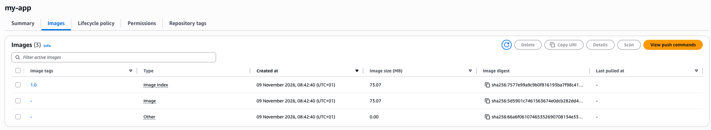
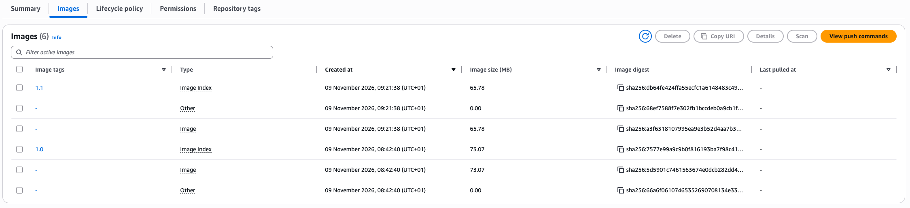

# Create repository on AWS and push to private Docker registry

**Technologies used:**
Docker, Amazon ECR

**Project Description:**
- Create private Docker registry on AWS (Amazon ECR)
- Tag and Push Docker image to this private repository

*Module 9: AWS Services*

 

*The `my-app` image was tagged with the ECR repository URI and pushed as version `1.0`. All layers were pushed successfully to the private registry in `eu-north-1`.*

 

*The `my-app` repository in Amazon ECR now shows the pushed image tagged `1.0` (73.07 MB).*

 

*After a code change, a new version was built, tagged `1.1` and pushed. ECR now holds both versions, `1.1` (65.78 MB) and `1.0`.*
